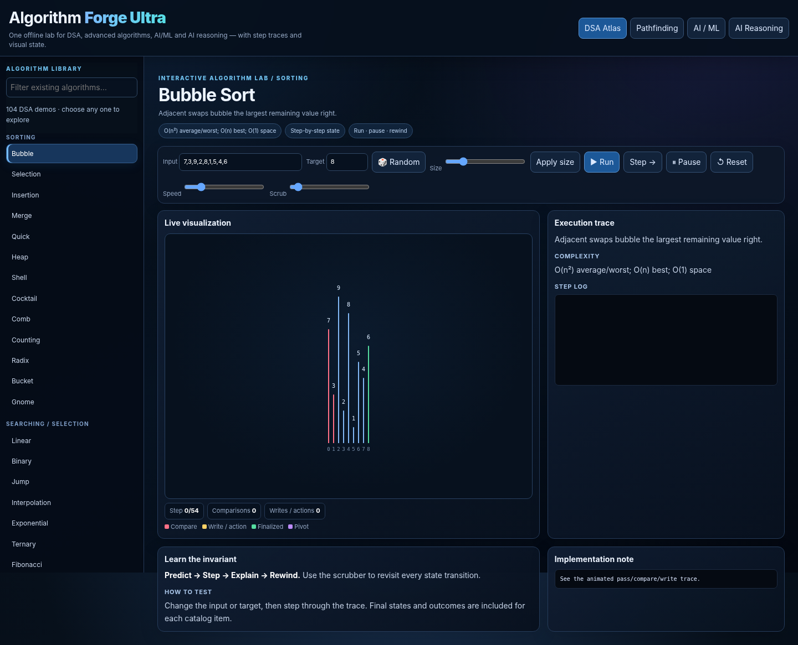

# ⚒️ Algorithm DSA VISUALIZER Forge Ultra

**Explore algorithms by watching them work.** Algorithm Forge Ultra is an interactive, browser-based lab for the existing DSA catalogue, pathfinding, AI/ML demos, and AI-reasoning demos. Inspect step-by-step traces, change inputs, and rewind execution states—all without a backend or build step.

> **Project goal:** make algorithm behavior easier to see, test, and understand. This repository preserves the existing catalogue; it does not add algorithms beyond the project scope.



## ✨ Features

- **DSA Atlas** — browse the existing catalogue of 104 DSA demos.
- **Pathfinding** — explore the 8 existing pathfinding algorithms.
- **AI / ML** — interact with 9 existing demonstrations.
- **AI Reasoning** — step through 8 existing reasoning demonstrations.
- **Step-by-step playback** — run, pause, step, scrub, and reset traces.
- **Editable inputs** — experiment with supported values and targets.
- **Responsive interface** — use the lab on desktop or mobile-sized screens.
- **No build tools or backend** — plain HTML, CSS, and JavaScript; host it as a static site.

**Catalogue count:** 129 demos total (104 DSA + 8 pathfinding + 9 AI/ML + 8 reasoning).

## 🚀 Run locally

1. Download or clone this repository.
2. Open `index.html` in a modern browser.
3. Select a demo and use **Step**, **Run**, **Pause**, **Scrub**, and **Reset** to explore it.

No npm install, API key, or server is required for the normal static-site build. If your browser restricts local files, serve the folder with any static HTTP server.

## 🌐 Publish with GitHub Pages

This repository includes a GitHub Actions workflow at `.github/workflows/pages.yml`.

1. Create a GitHub repository named `algorithm-forge-ultra` (or choose your own name).
2. Upload/push the **contents** of this project folder to the repository root. `index.html`, `css/`, and `js/` should be at the root level—not nested in another project folder.
3. In GitHub, open **Settings → Pages** and set the build/deployment source to **GitHub Actions**.
4. Open the **Actions** tab and wait for the Pages workflow to finish successfully.
5. Your site URL will be shown in the Pages deployment details and under **Settings → Pages**.

Every push to `main` triggers a deployment. If your default branch is named differently, update the branch filter in `.github/workflows/pages.yml`.

## 🧪 Browser self-test

Open `index.html#autotest` in a browser. The built-in test harness displays a JSON report and checks catalogue coverage, algorithm outcomes/invariants, representative visualization states, and interactions.

### Recorded verification

The supplied repair build was tested in Chromium 144 on 12 October 2026:

- **1,414/1,414** automated browser assertions passed across the 129 demos.
- **20/20** additional interaction checks passed.
- No JavaScript page errors or browser-console errors were observed in those runs.

See [`BROWSER_TEST_REPORT.md`](BROWSER_TEST_REPORT.md) for the recorded test details. These results describe that test environment; they are not a guarantee that every browser engine/device has been independently tested. Please run the self-test and manually check your target devices before relying on a deployment.

## 🗂️ Repository structure

```text
algorithm-forge-ultra/
├── index.html
├── css/
│   └── styles.css
├── js/
│   └── app.js
├── assets/
│   └── preview.png
├── .github/
│   └── workflows/
│       └── pages.yml
├── BROWSER_TEST_REPORT.md
├── CONTRIBUTING.md
├── LICENSE
└── README.md
```

## 🤝 Contributing

Bug reports, reproducible test cases, accessibility improvements, and focused fixes are welcome. Please read [`CONTRIBUTING.md`](CONTRIBUTING.md) before opening an issue or pull request.

## ⭐ Support the project

If this project is useful, **star the repository on GitHub** and share the live demo with students, educators, and developers who may find it helpful. Stars are voluntary; do not use bots, paid/fake engagement, or spam to obtain them.

## 📄 License

Released under the MIT License. See [`LICENSE`](LICENSE).
